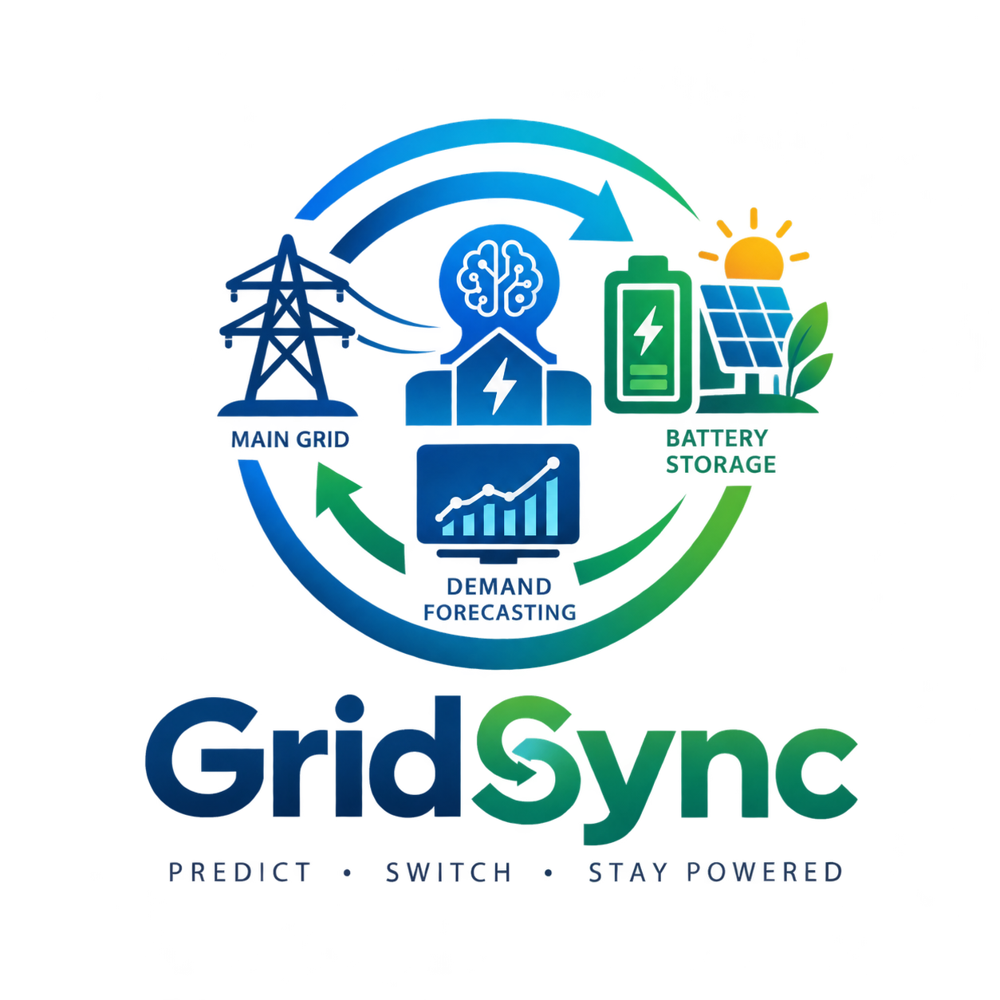

# GridSync — Smart Energy Microgrid & Demand Forecasting Engine

> **PREDICT · SWITCH · STAY POWERED**

GridSync is an automated microgrid energy management and demand forecasting web application built for the **HackSphere 3.0** challenge. It predicts hourly electricity demand 24 hours in advance, simulates solar generation and battery storage dynamics, and automatically dispatches power between the Main City Grid and local Battery Storage (BESS) to reduce electricity costs, cut carbon emissions, and prevent blackouts.



---

## ⚡ Core Switching Rules

The microgrid controller continuously evaluates incoming telemetry against three automated rules:

1. **Evening Peak Window (6:00 PM – 10:00 PM)**
   - When electricity prices surge during evening peak demand, GridSync automatically switches to **Renewable Battery Storage Mode** to avoid expensive utility rates.
2. **Heavy Power Demand (> 160 kW)**
   - When building power spikes above 160 kW, the battery discharges to shave the peak and avoid utility penalty charges.
3. **Critical Overload Warning (≥ 200 kW)**
   - When total power hits or exceeds 200 kW, an emergency **Critical Overload Alert** triggers, and the battery inverter fires at maximum output to protect local transformers and breakers.

Outside of peak hours and below 160 kW, the system operates in **Main Grid Mode**, utilizing steady, affordable utility power while allowing solar panels to recharge the battery bank.

---

## 🚀 Getting Started

### Prerequisites

- Node.js (v18 or higher)
- npm or pnpm

### Installation

```bash
# Clone the repository
git clone https://github.com/saintsupreme541-pixel/Grid-sync.git
cd Grid-sync

# Install dependencies
npm install

# Start development server
npm run dev
```

The application will be live at `http://localhost:3000`.

---

## 🔌 API Endpoints

GridSync includes an integrated Node.js API supporting both browser and external client calls:

### 1. Health Check

```bash
curl http://localhost:3000/api/health
```

**Response:**
```json
{
  "status": "ok",
  "service": "GridSync Microgrid Forecasting API",
  "version": "3.0.0",
  "switchingRules": {
    "renewableStorageThresholdKw": 160.0,
    "peakHoursWindow": "18:00 - 22:00",
    "criticalOverloadThresholdKw": 200.0
  }
}
```

### 2. Telemetry Ingestion & Forecast

```bash
curl -X POST http://localhost:3000/api/evaluate \
  -H "Content-Type: application/json" \
  -d '{
    "data": [
      {
        "timestamp": "2015-06-16 19:00:00",
        "ambient_temp_c": 32.5,
        "humidity_pct": 60.0,
        "solar_irradiance_wm2": 450.0
      }
    ]
  }'
```

**Response:**
```json
{
  "status": "success",
  "results": [
    {
      "timestamp": "2015-06-16 19:00:00",
      "predicted_demand_kw": 184.49,
      "grid_mode": "Renewable Storage Mode",
      "critical_overload_alert": false,
      "base_load_kw": 112.24,
      "cooling_load_kw": 72.25,
      "solar_generation_kw": 54.0,
      "homes_equivalent": 74,
      "is_peak_hours": true
    }
  ]
}
```

---

## 📊 Features & UI Highlights

- **How It Works Guided Tour**: Beginner-friendly explanations of microgrid concepts and 1-click test scenarios (*Sunny Noon*, *7 PM Peak Rush*, *Heatwave Overload*, *Quiet Night*).
- **Power Flow Topology**: Interactive animated diagram tracking power transfers between City Grid, Rooftop Solar, Battery Bank, and Facility Offices.
- **24-Hour Forecast Timeline**: Interactive SVG load curve with clickable scrubber, threshold lines (160 kW, 200 kW), and shaded peak pricing window.
- **Batch CSV Ingestion**: Drag-and-drop CSV upload for 24-hour test datasets, real-time filtering, and one-click export for `predictions.csv`.
- **Real-World Impact Metrics**: Instant calculation of homes powered equivalent, dollars saved per hour, and kg of CO₂ offset.

---

## 📜 License

Apache-2.0
